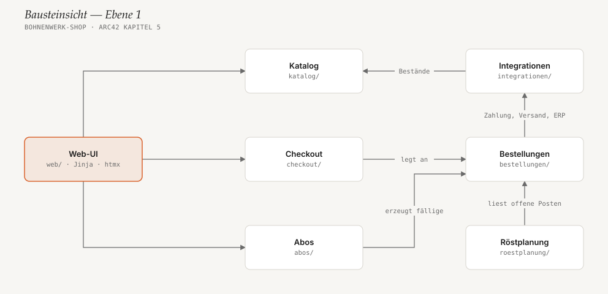

# 5. Bausteinsicht

<!-- status: vollständig -->

## 5.1 Whitebox Gesamtsystem (Ebene 1)

Der Shop ist ein modularer Monolith ([ADR-001](09-architekturentscheidungen.md#adr-001-modularer-monolith-statt-microservices)).
Jeder Baustein ist ein Python-Paket unter `src/bohnenwerk/` mit einer
öffentlichen Schnittstelle in `api.py`; andere Bausteine dürfen nur diese
importieren. Ein Import-Linter in der CI (`import-linter`) prüft das.

Ebene 1 zeigt die Fachmodule des Monolithen, Ebene 2 die Komponenten eines
Moduls — das entspricht Level 3 („Component“) im C4-Modell. Die
Schnittstellen der Komponenten stehen gesammelt in [5.3](#53-schnittstellen).

Pfeile bedeuten „nutzt“. Die Backoffice-Seiten der Web-UI lesen zusätzlich
Bestellungen und Röstplanung — diese Kanten fehlen im Bild, damit es lesbar
bleibt.

| Baustein | Verantwortung | Schnittstelle (Auszug) |
|---|---|---|
| **Web-UI** | Alle Seiten für Kund:innen und Backoffice, Session, Formulare. Enthält keine Fachlogik. | HTTP-Routen, Jinja-Templates |
| **Katalog** | Sorten, Preise, Röststufen, verkaufbarer Bestand inkl. Sicherheitsbestand. | `sorten()`, `verfuegbar(sorte)` |
| **Checkout** | Warenkorb, Adressen, Versandart; übergibt einen geprüften Warenkorb an Bestellungen. | `warenkorb(session)`, `abschliessen()` |
| **Abos** | Abo-Verträge, Intervalle, Pausen; erzeugt täglich um 06:00 fällige Bestellungen. | `abschliessen()`, `pausieren()`, `faellige_erzeugen()` |
| **Bestellungen** | Lebenszyklus einer Bestellung von „angelegt“ bis „versandt“, Zahlstatus, Outbox. Herzstück des Systems. | `anlegen()`, `offene_posten(bis)`, `als_gepackt_markieren()` |
| **Röstplanung** | Bildet zum Cutoff Chargen je Sorte und ordnet Bestellposten zu. | `cutoff(tag)`, `roestplan(tag)` |
| **Integrationen** | Adapter zu PSP, Mail-Dienst, ERP und Versanddienstleister; Webhook-Endpunkt des PSP; nächtlicher ERP-Abgleich. | `psp.session_anlegen()`, `erp.abgleich()` |

## 5.2 Whitebox Bestellungen (Ebene 2)

Bestellungen bekommt eine eigene Ebene, weil hier das wichtigste
Qualitätsziel entschieden wird: Zahlungen und ihre Folgen dürfen weder
verloren gehen noch doppelt passieren. Zerlegt ist nach Auslöser: Aufrufe
aus dem Shop, Ereignisse vom PSP, Folgeaktionen für den Worker.

| Komponente | Verantwortung | Bietet an | Nutzt |
|---|---|---|---|
| **Bestell-Service** (`service.py`) | Legt Bestellungen an, führt Statusübergänge durch (Zustandsautomat in `status.py`), storniert. | IF-01 | IF-04 |
| **Zahlungsabgleich** (`zahlung.py`) | Verarbeitet PSP-Events; jede Event-ID genau einmal. | IF-02 | IF-04 |
| **Outbox** (`outbox.py`) | Nimmt Folge-Events in der Transaktion des Aufrufers an und hält sie für den Worker bereit. | IF-03, IF-04 | — |

Der Worker ist kein Teil von Bestellungen: Er holt neue Outbox-Einträge ab und
stellt sie als Jobs in die Redis-Queue. Details in
[8.1](08-querschnittliche-konzepte.md#81-transaktionale-outbox).

### Bestell-Service

**Zweck.** Einzige Stelle, an der eine Bestellung entsteht oder ihren Status
ändert.

**Ablage.** `src/bohnenwerk/bestellungen/service.py`, `status.py`

**Bietet an:** [IF-01](#if-01-bestell-api) · **Nutzt:** [IF-04](#53-schnittstellen),
Tabellen `bestellung`, `bestellposten`

**Qualitätsmerkmale.** Jeder Statusübergang läuft durch den Zustandsautomaten;
unerlaubte Übergänge (z. B. `versandt` → `bezahlt`) werfen eine Exception,
statt still zu scheitern.

**Offene Punkte.** Siehe IF-01: Ob `anlegen()` bei doppeltem Absenden idempotent
ist, ist nicht belegt.

### Zahlungsabgleich

**Zweck.** Übersetzt Zahlungsereignisse des PSP in Statusänderungen — und ist
der einzige Weg dorthin ([ADR-003](09-architekturentscheidungen.md#adr-003-zahlstatus-nur-aus-webhooks)).

**Ablage.** `src/bohnenwerk/bestellungen/zahlung.py`

**Bietet an:** [IF-02](#if-02-zahlungsereignis-verarbeiten) · **Nutzt:**
[IF-04](#53-schnittstellen), Tabellen `bestellung`, `psp_event`

**Qualitätsmerkmale.** Genau-einmal-Verarbeitung je Event-ID über einen
Unique-Constraint, nicht über Anwendungslogik.

### Outbox

**Zweck.** Garantiert, dass jede Folgeaktion genau dann geplant ist, wenn die
auslösende Zustandsänderung gespeichert wurde.

**Ablage.** `src/bohnenwerk/bestellungen/outbox.py`, Tabelle `outbox`

**Bietet an:** [IF-03](#if-03-outbox-events), [IF-04](#53-schnittstellen)

**Qualitätsmerkmale.** Kein eigener Commit — Schreiben ohne laufende
Transaktion des Aufrufers ist ein Programmierfehler.

## 5.3 Schnittstellen

| ID | Name | Anbieter | Nutzer | Art | Vertrag |
|---|---|---|---|---|---|
| IF-01 | Bestell-API | Bestell-Service | Checkout, Abos, Röstplanung, Web-UI | Python-Aufruf, synchron | `bestellungen/api.py` |
| IF-02 | Zahlungsereignis verarbeiten | Zahlungsabgleich | Integrationen (PSP-Webhook) | Python-Aufruf, synchron | `bestellungen/api.py` |
| IF-03 | Outbox-Events | Outbox | Worker | gemeinsame Tabelle, Polling | Tabelle `outbox`, Event-Klassen in `bestellungen/events.py` |
| IF-04 | Outbox schreiben | Outbox | Bestell-Service, Zahlungsabgleich | Python-Aufruf, intern | `outbox.schreibe()` |

IF-04 ist nur innerhalb von Bestellungen sichtbar und hat deshalb keinen
Steckbrief.

### IF-01: Bestell-API

| | |
|---|---|
| **Anbieter → Nutzer** | Bestell-Service → Checkout, Abos, Röstplanung, Web-UI (Backoffice) |
| **Art** | synchroner Funktionsaufruf im selben Prozess |
| **Vertrag** | `src/bohnenwerk/bestellungen/api.py` — andere Module dürfen nur dieses Modul importieren (Import-Linter) |
| **Operationen** | `anlegen(warenkorb)` → Bestellung im Status `wartet_auf_zahlung` · `offene_posten(bis)` → bezahlte Posten ohne Charge · `als_gepackt_markieren(id)` · `stornieren(id)` |
| **Fehlerverhalten** | Unerlaubter Statusübergang → `UngueltigerStatusuebergang`; Aufrufer zeigen eine Meldung, es gibt keinen automatischen Retry |
| **Garantien** | Jede Operation ist eine Transaktion. Idempotenz von `anlegen()` bei Doppelklick: **offen** |
| **Version / Stabilität** | intern, ändert sich mit dem Monolithen; Änderungen nur zusammen mit allen Nutzern |

### IF-02: Zahlungsereignis verarbeiten

| | |
|---|---|
| **Anbieter → Nutzer** | Zahlungsabgleich → Integrationen (Endpunkt `POST /webhooks/psp`) |
| **Art** | synchroner Funktionsaufruf, ausgelöst durch den PSP-Webhook |
| **Vertrag** | `zahlung_eingegangen(session, event)` in `bestellungen/api.py`; Webhook-Format: Doku des PSP |
| **Fehlerverhalten** | Unbekannte Bestell-ID → Exception, Integrationen antwortet `500`, der PSP wiederholt |
| **Garantien** | Genau einmal je `psp_event.id`; Duplikate werden mit `200` quittiert. Reihenfolge **nicht** garantiert ([ADR-003](09-architekturentscheidungen.md#adr-003-zahlstatus-nur-aus-webhooks)). Commit macht der Aufrufer — Status und Outbox-Event gemeinsam oder gar nicht |
| **Sicherheit** | Integrationen prüft die HMAC-Signatur, bevor IF-02 aufgerufen wird |

### IF-03: Outbox-Events

| | |
|---|---|
| **Anbieter → Nutzer** | Outbox → Worker |
| **Art** | gemeinsame Tabelle `outbox`, Worker pollt alle 5 Sekunden (`SELECT … FOR UPDATE SKIP LOCKED`) |
| **Events** | `BestellungBezahlt`, `BestellungVersandt`, `BestellungStorniert` |
| **Fehlerverhalten** | Bis zu 8 Wiederholungen mit Backoff, danach `dead_letter` und Mail ans Team ([8.1](08-querschnittliche-konzepte.md#81-transaktionale-outbox)) |
| **Garantien** | at-least-once; jeder Handler muss idempotent sein ([8.2](08-querschnittliche-konzepte.md#82-idempotenz)). Reihenfolge **nicht** garantiert — Wiederholungen überholen spätere Events |
| **Version / Stabilität** | Neue Felder nur additiv — beim Deployment können alte Einträge noch in der Tabelle liegen |
