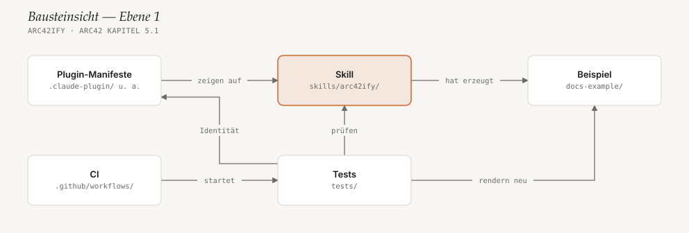

# 5. Bausteinsicht

<!-- status: vollständig -->

## 5.1 Whitebox Gesamtsystem (Ebene 1)

Das Repo enthält genau einen Baustein, der bei Nutzer:innen landet: den
Skill-Ordner `skills/arc42ify/`. Alles andere — Manifeste, Tests, Beispiel,
Handbuch — dient dazu, ihn zu verteilen, abzusichern oder zu erklären.
Ebene 2 zeigt die Komponenten des Skills (C4: Level 3 „Component“), ihre
Schnittstellen stehen gesammelt in [5.4](#54-schnittstellen).

Pfeile bedeuten „nutzt“ bzw. „prüft“. Das Handbuch unter `docs/` fehlt im
Bild; es verlinkt nur auf die anderen Bausteine.

| Baustein | Verantwortung | Wo |
|---|---|---|
| **Skill** | Anleitung für den Agenten plus die drei Scripts. Der einzige Ordner, der installiert wird. Siehe [5.2](#52-whitebox-skill-ebene-2). | [`skills/arc42ify/`](../../skills/arc42ify/SKILL.md) |
| **Plugin-Manifeste** | Machen das Repo zu Plugin *und* Marketplace. Claude Code und Copilot CLI lesen `.claude-plugin/`, Codex liest `.codex-plugin/` und `.agents/plugins/`. Alle zeigen auf denselben Skill-Ordner. | [`.claude-plugin/`](../../.claude-plugin/plugin.json), [`.codex-plugin/`](../../.codex-plugin/plugin.json), [`.agents/plugins/`](../../.agents/plugins/marketplace.json) |
| **Tests** | Eine Datei, neun Testklassen, nur `unittest`. Rendern alle ausgelieferten Diagramme neu (Vorlagen, Beispiel, diese Doku), prüfen den Router, den Selbstcheck (mit kaputten und guten Fixtures), die CLI, das Gerüst, die Skill-Metadaten, die Manifeste und alle Markdown-Links. | [`tests/test_arc42ify.py`](../../tests/test_arc42ify.py), `tests/fixtures/{fail,pass}/` |
| **CI** | Führt die Tests bei jedem Push auf `master`/`main` und bei jedem Pull Request aus — auf Python 3.8, 3.13 und unter Windows. | [`.github/workflows/ci.yml`](../../.github/workflows/ci.yml) |
| **Beispiel „Bohnenwerk-Shop“** | Vollständig ausgefüllte, fiktive arc42-Doku mit 7 Diagrammen. Zeigt Nutzer:innen das Ergebnis und dient den Tests als Regressionsmaterial. | [`docs-example/`](../../docs-example/README.md) |
| **Handbuch** | Installation je Host, Nutzung, Vision und Roadmap — für Menschen. | [`docs/`](../usage.md), [README](../../README.md), [CONTRIBUTING](../../CONTRIBUTING.md) |

## 5.2 Whitebox Skill (Ebene 2)

Der Skill ist nach Art der Datei zerlegt: Anleitung für den Agenten
(Markdown), Beispiele zum Kopieren (JSON + SVG) und drei Scripts, die der
Agent im Terminal aufruft. Nur die Scripts enthalten Code.

Die Pfeile von `SKILL.md` zu den Scripts stehen für „beschreibt den
Aufruf“: Ausführen tut sie der Agent, in der Reihenfolge Gerüst → rendern →
prüfen ([6.1](06-laufzeitsicht.md#61-doku-für-ein-repo-erzeugen)). Die
hervorgehobene Kante ist die wichtigste Kopplung im Code: Der Selbstcheck
hat keine eigene Geometrie, sondern importiert die des Renderers.

| Komponente | Verantwortung | Bietet an | Nutzt |
|---|---|---|---|
| **`SKILL.md`** | Frontmatter und der Ablauf in fünf Schritten: Quelle bestimmen → Gerüst → pro Kapitel Fakten, Text, Bild → Diagramme rendern und prüfen → Index und Zusammenfassung. | IF-01 | `references/`, `assets/templates/`, IF-03, IF-05, IF-06 |
| **`references/`** | Wissen, das der Agent nur bei Bedarf lädt: [`arc42-sections.md`](../../skills/arc42ify/references/arc42-sections.md) (Kapitel → Quelle im Code → Diagrammtyp), [`building-block-view.md`](../../skills/arc42ify/references/building-block-view.md) (Ebenen, Blackbox, Schnittstellen-Steckbrief), [`diagram-spec.md`](../../skills/arc42ify/references/diagram-spec.md) (Vertrag von IF-02), [`style-guide.md`](../../skills/arc42ify/references/style-guide.md) (Design-Tokens), [`multi-agent-usage.md`](../../skills/arc42ify/references/multi-agent-usage.md) (Installationspfade je Host). | — | — |
| **`assets/templates/`** | Sechs Beispiel-Specs (Kontext, Bausteine, Whitebox, Verteilung, Schichten, Sequenz) mit gerenderten SVGs. Startpunkte zum Kopieren, keine Pflichtstruktur. | Beispiele für IF-02 | — |
| **`scaffold.py`** | Legt das Gerüst `docs/arc42/` an. | IF-06 | — |
| **`render_diagram.py`** | JSON-Spec → SVG für alle drei Diagrammarten. Siehe [5.3](#53-whitebox-render_diagrampy-ebene-3). | IF-02, IF-03, IF-04 | — |
| **`self_check.py`** | Prüft Spec, Geometrie und SVG. | IF-05 | IF-02, IF-04 |

### `SKILL.md`

**Zweck.** Bringt dem Agenten bei, wann der Skill passt und in welcher
Reihenfolge er arbeitet.

**Ablage.** [`skills/arc42ify/SKILL.md`](../../skills/arc42ify/SKILL.md)

**Bietet an:** [IF-01](#if-01-skill-anleitung) · **Nutzt:** `references/`,
`assets/templates/`, [IF-03](#54-schnittstellen), [IF-05](#54-schnittstellen),
[IF-06](#54-schnittstellen)

**Qualitätsmerkmale.** Der Host entscheidet nur anhand der `description`,
ob er den Skill lädt — sie trägt deshalb die Trigger-Wörter auf Deutsch und
Englisch ([TR3/TR4](02-randbedingungen.md#21-technische-randbedingungen)).
Alles, was nicht jedes Mal gebraucht wird, steht in `references/`.

### `render_diagram.py`

**Zweck.** Macht aus einer fachlichen Beschreibung (Knoten, Kanten,
Beschriftungen) ein fertig gestaltetes SVG — Layout und Stil sind nie Sache
des Agenten.

**Ablage.** [`skills/arc42ify/scripts/render_diagram.py`](../../skills/arc42ify/scripts/render_diagram.py), nur Standardbibliothek

**Bietet an:** [IF-02](#if-02-diagramm-spec), [IF-03](#54-schnittstellen),
[IF-04](#if-04-layout-api)

**Qualitätsmerkmale.** Deterministisch: Dieselbe Spec ergibt Byte für Byte
dasselbe SVG, auf jedem Betriebssystem (LF-Zeilenenden). Die Tests vergleichen
jedes ausgelieferte SVG mit einem frischen Rendering. Kein Netzwerk, keine
Schriftdateien — Textbreiten sind geschätzt
([8.4](08-querschnittliche-konzepte.md#84-geschätzte-textbreiten)).

**Offene Punkte.** Gruppen lassen sich nicht verschachteln: Zwei Gruppen um
dieselben Knoten hätten deckungsgleiche Ränder.

### `self_check.py`

**Zweck.** Findet Fehler in einem Diagramm, bevor ein Mensch sie sieht —
damit der Agent sie selbst korrigieren kann.

**Ablage.** [`skills/arc42ify/scripts/self_check.py`](../../skills/arc42ify/scripts/self_check.py)

**Bietet an:** [IF-05](#54-schnittstellen) · **Nutzt:** [IF-02](#if-02-diagramm-spec),
[IF-04](#if-04-layout-api)

**Qualitätsmerkmale.** Prüft die Geometrie, die der Renderer *tatsächlich*
erzeugt, statt sie nachzurechnen. Jede Regel hat ein Fixture, das sie
auslösen muss (`tests/fixtures/fail/`).

### `scaffold.py`

**Zweck.** Legt die 13 Kapiteldateien und den Diagrammordner an, damit jede
Doku dieselbe Struktur hat.

**Ablage.** [`skills/arc42ify/scripts/scaffold.py`](../../skills/arc42ify/scripts/scaffold.py)

**Bietet an:** [IF-06](#54-schnittstellen)

**Qualitätsmerkmale.** Überschreibt nie eine vorhandene Datei — sicher bei
wiederholtem Aufruf.

## 5.3 Whitebox `render_diagram.py` (Ebene 3)

Hier passiert fast jede Änderung. Die Datei ist in Abschnitte gegliedert,
die mit `# ---- …` beginnen:

| Abschnitt | Wichtige Namen | Aufgabe |
|---|---|---|
| Konstanten und Tokens | `GRID`, `STEP`, `NODE_W`/`NODE_H`, `CELL_W`/`CELL_H`, `*_COST`, `DEFAULT_THEME` | Alle Maße und Routing-Kosten an einer Stelle. `DEFAULT_THEME` spiegelt [`style-guide.md`](../../skills/arc42ify/references/style-guide.md). |
| Textmetrik | `mono_width`, `sans_width`, `title_width`, `edge_label_size` | Schätzt Textbreiten ohne Schriftdatei ([8.4](08-querschnittliche-konzepte.md#84-geschätzte-textbreiten)). |
| Geometrie-Helfer | `rects_overlap`, `segment_hits_rect`, `crosses_border`, `segments`, `simplify` | Von Router, Label-Platzierung **und** `self_check.py` genutzt. |
| `boxes`: Layout | `node_rect`, `group_geometry`, `Router`, `place_label`, `layout_boxes` | Knoten aufs Raster, Kanten routen, Labels platzieren. `layout_boxes` gibt die komplette Geometrie zurück. Kanten zwischen zwei Teilen einer `box`-Gruppe bleiben in der Gruppe; Labels landen nie auf deren Rahmen. |
| `boxes`: Zeichnen | `node_svg`, `group_box_svg`, `edge_label_svg`, `render_boxes` | Zeichnet in fester Reihenfolge: Gruppen → Kanten → Knoten → Labels, damit nie ein Label übermalt wird. `group_box_svg` zeichnet eine `box`-Gruppe als gefüllten Baustein mit Titel. |
| `layers` | `render_layers` | Gestapelte Schichten mit Stichworten. Kein eigenes Layout nötig. |
| `sequence` | `layout_sequence`, `render_sequence` | Lebenslinien, eine Zeile je Nachricht, Selbstaufrufe als Schleife. |
| Rahmen | `RENDERERS`, `marker_defs`, `render_svg`, `render` | Wählt den Renderer nach `kind`, setzt Titel, Rand und Pfeilspitzen, schreibt die Datei mit LF. |

**Router in Kürze.** Jede Box plus ein Gitterschritt Rand ist gesperrt,
dadurch halten Kanten mindestens 24px Abstand zu fremden Boxen. Jede Kante startet
und endet an einem eigenen Anschlusspunkt („Port“) auf einer Boxseite. Die
Suche ist Dijkstra über (Punkt, Richtung) auf einem 12px-Gitter; Kosten
entstehen für Länge, Knicke, Kreuzungen, gemeinsam genutzte Strecken und
Wege durch bereits platzierte Labels. Kanten zwischen direkten Nachbarn
werden zuerst geroutet, dann nach Abstand — so bekommen einfache Kanten die
geraden Wege. Ablauf siehe [6.2](06-laufzeitsicht.md#62-ein-boxes-diagramm-rendern).

## 5.4 Schnittstellen

| ID | Name | Anbieter | Nutzer | Art | Vertrag |
|---|---|---|---|---|---|
| IF-01 | Skill-Anleitung | `SKILL.md` | Agent-Host | Markdown mit YAML-Frontmatter | [Agent-Skills-Format](https://agentskills.io/specification), Regeln in [TR3/TR4](02-randbedingungen.md#21-technische-randbedingungen) |
| IF-02 | Diagramm-Spec | `render_diagram.py` | Agent, `self_check.py` | JSON-Datei | [`diagram-spec.md`](../../skills/arc42ify/references/diagram-spec.md) |
| IF-03 | Render-CLI | `render_diagram.py` | Agent | Kommandozeile | `render_diagram.py <spec> <svg>` |
| IF-04 | Layout-API | `render_diagram.py` | `self_check.py`, Tests | Python-Import | `render_svg`, `layout_boxes`, `layout_sequence`, Geometrie-Helfer |
| IF-05 | Check-CLI | `self_check.py` | Agent, Tests | Kommandozeile und Python-Import | `self_check.py <spec> [<svg>]`; `check(spec)`, `check_svg(text)` |
| IF-06 | Gerüst-CLI | `scaffold.py` | Agent | Kommandozeile | `scaffold.py <repo> [--lang de\|en]` |

IF-03, IF-05 und IF-06 sind einfache Kommandozeilen ohne Optionen außer den
genannten; sie haben keinen eigenen Steckbrief. Gemeinsam ist ihnen: nur
Standardbibliothek, Python 3.8+, Ausgabe auf einer Konsole, die nicht jedes
Zeichen darstellen kann, bricht nicht ab.

### IF-01: Skill-Anleitung

| | |
|---|---|
| **Anbieter → Nutzer** | `SKILL.md` → Agent-Host (Claude Code, GitHub Copilot, OpenAI Codex) |
| **Art** | Markdown-Datei, vom Host gelesen; Frontmatter `name`, `description`, `license`, `compatibility` |
| **Fehlerverhalten** | Passt die `description` nicht zur Bitte, lädt der Host den Skill gar nicht — ohne Fehlermeldung |
| **Garantien** | `name` = Ordnername, höchstens 64 Zeichen; `description` höchstens 1024 Zeichen, gültiges YAML ohne Anführungszeichen, enthält die Trigger-Wörter; `SKILL.md` unter 500 Zeilen (Test `SkillMetadata`) |
| **Version / Stabilität** | Version steht in den Plugin-Manifesten, nicht in `SKILL.md` |

### IF-02: Diagramm-Spec

| | |
|---|---|
| **Anbieter → Nutzer** | `render_diagram.py` (definiert das Format) → Agent (schreibt Specs), `self_check.py` (liest sie) |
| **Art** | JSON-Datei `<kapitel>-<name>.diagram.json` neben dem SVG |
| **Vertrag** | [`diagram-spec.md`](../../skills/arc42ify/references/diagram-spec.md); Beispiele unter `assets/templates/` |
| **Operationen** | `kind`: `boxes` (Knoten, Kanten, Gruppen, Gruppen-Art `box`), `layers`, `sequence`; gemeinsam `title`, `subtitle`, `theme` |
| **Fehlerverhalten** | Der Renderer prüft das Format nicht — eine kaputte Spec ergibt einen Python-Fehler oder ein schiefes Bild. Prüfen ist Aufgabe von IF-05 |
| **Garantien** | Gleiche Spec → byte-gleiches SVG. Unbekannte Felder werden ignoriert |
| **Version / Stabilität** | Ohne Versionsfeld; neue Felder nur optional, damit alte Specs weiter rendern. Die Tests rendern alle ausgelieferten Specs neu |

### IF-04: Layout-API

| | |
|---|---|
| **Anbieter → Nutzer** | `render_diagram.py` → `self_check.py`, `tests/test_arc42ify.py` |
| **Art** | Python-Import im selben Prozess (`import render_diagram as rd`) |
| **Operationen** | `render_svg(spec)` → SVG-Text · `layout_boxes(spec)` → Knoten-Rechtecke, Gruppen (mit `kind`, Rahmen, Titel-Rechteck), Kanten mit Punkten und Label-Rechteck · `layout_sequence(spec)` → Lanes und Zeilen · Helfer `rects_overlap`, `segment_hits_rect`, `crosses_border`, `sans_width`, `mono_width` |
| **Fehlerverhalten** | Keine eigenen Exceptions; findet der Router keinen Port, beendet `SystemExit` den Prozess |
| **Garantien** | Der Checker sieht genau die Geometrie, die gezeichnet wird — es gibt keine zweite Implementierung ([ADR-005](09-architekturentscheidungen.md#adr-005-selbstcheck-nutzt-die-layout-funktionen-des-renderers)) |
| **Version / Stabilität** | Intern. Änderungen an der Rückgabe von `layout_boxes` müssen `self_check.py` und die Tests im selben Commit anpassen |
